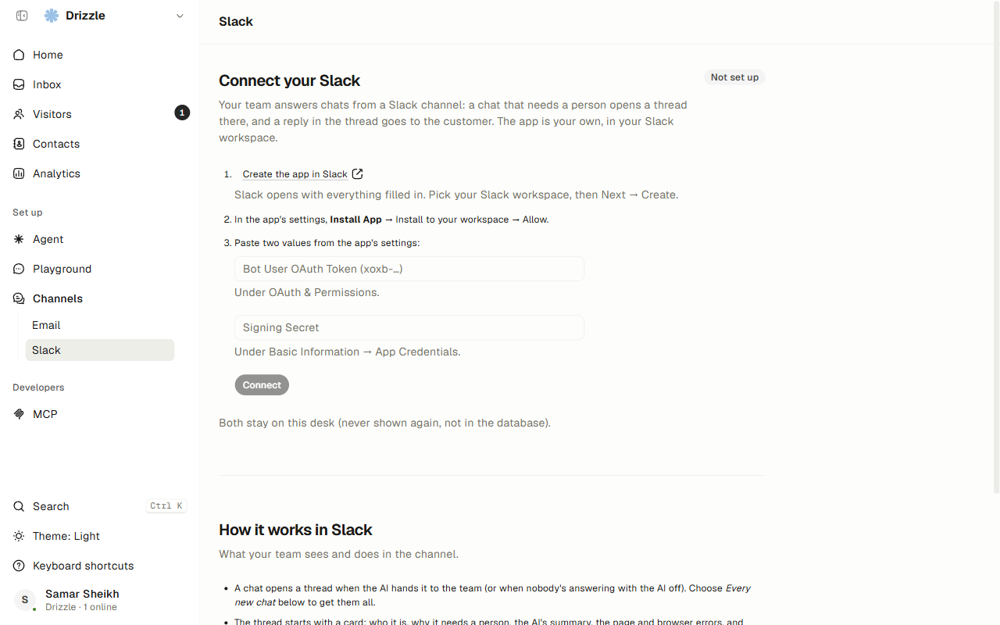
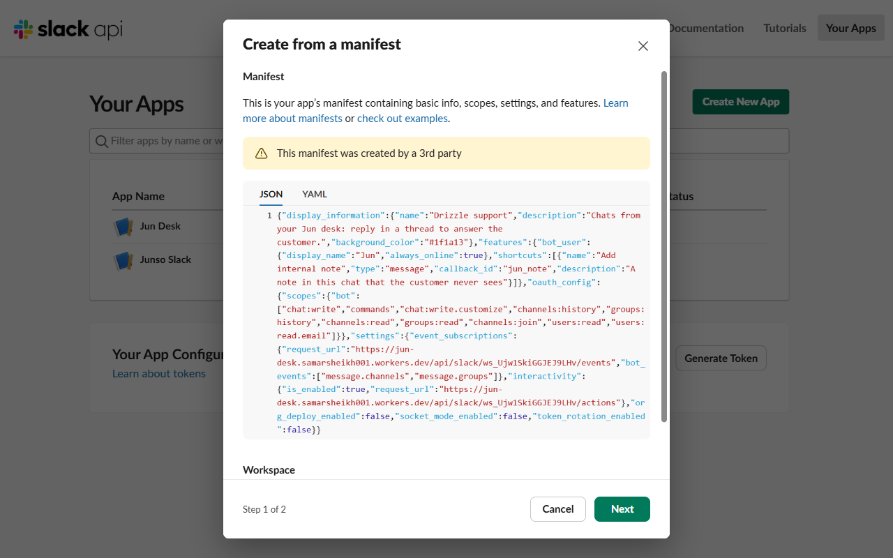
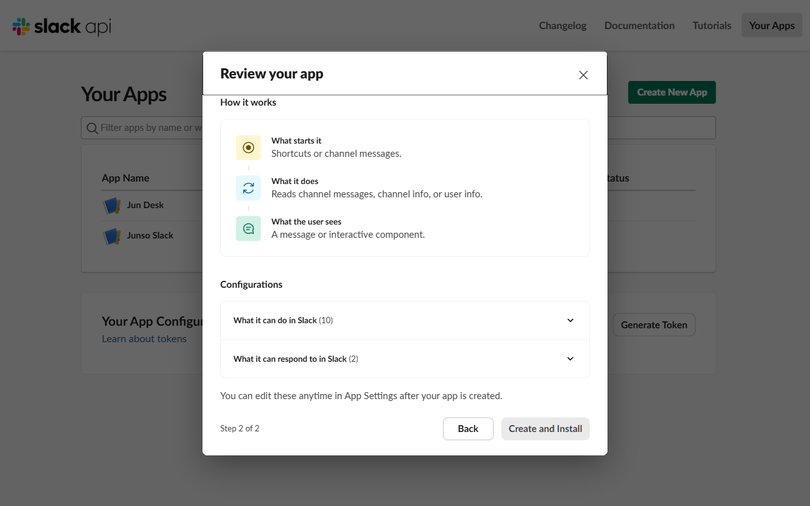
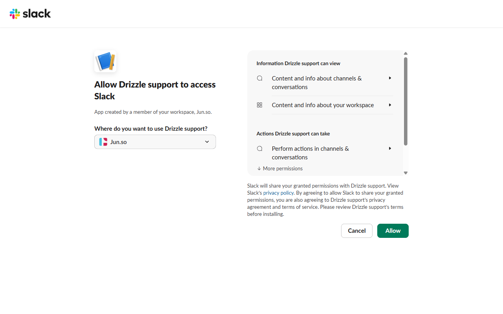
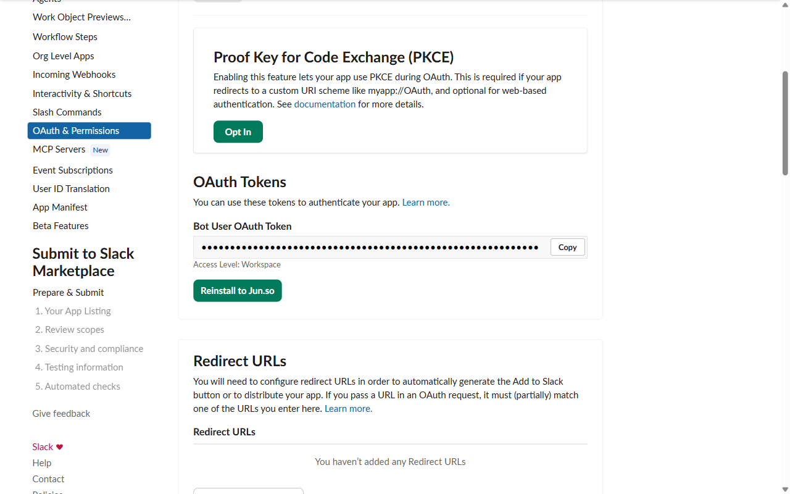
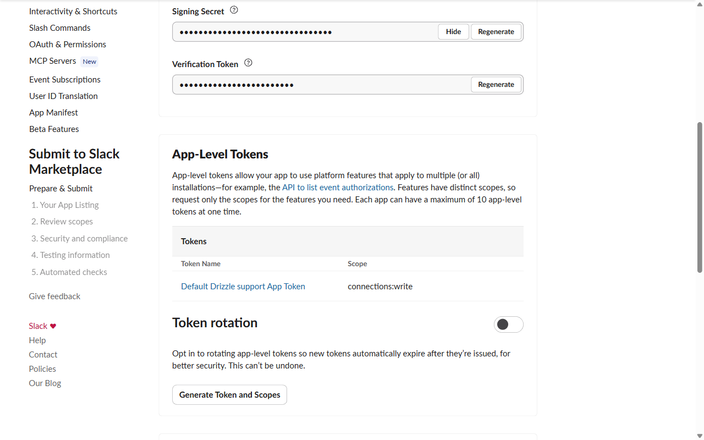
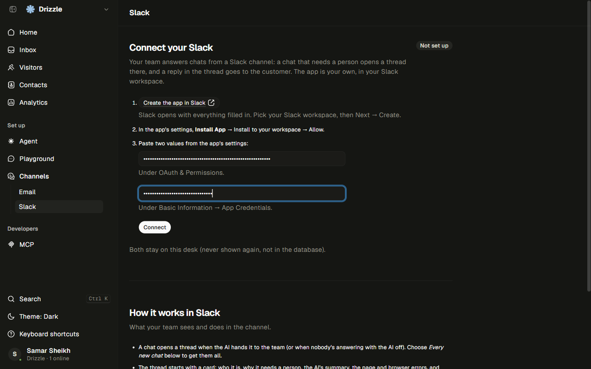
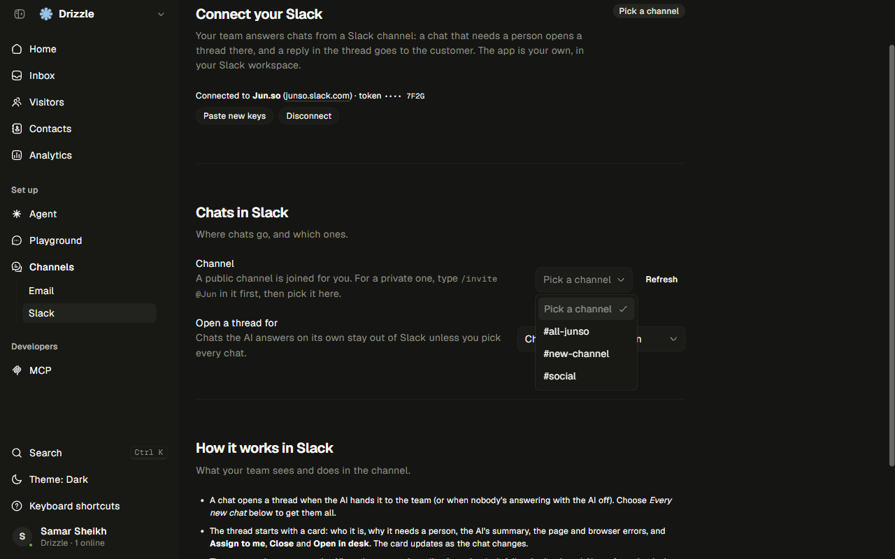
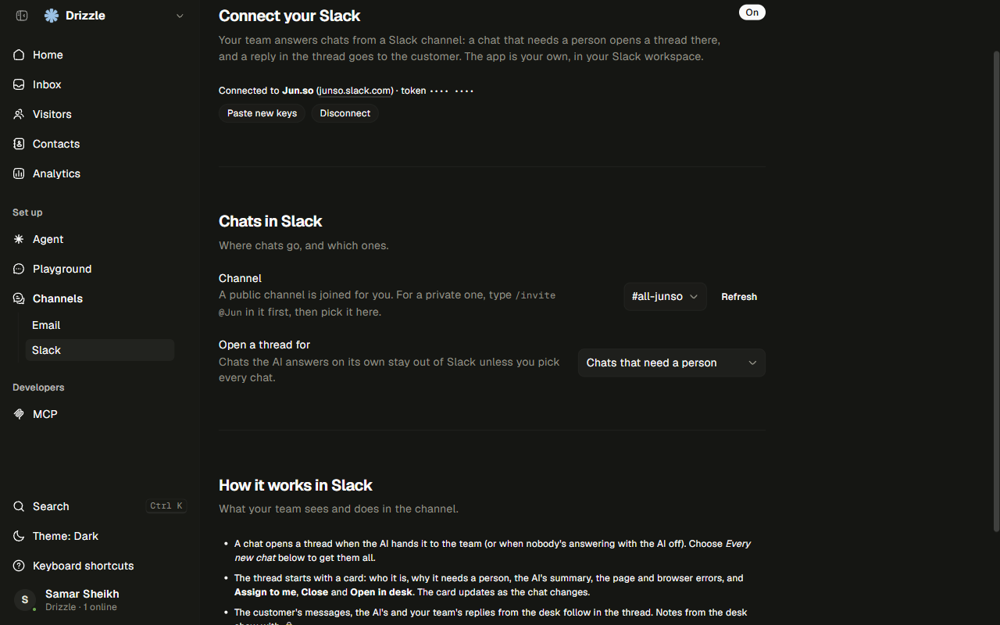

# Connect Slack to your desk

This is for desk owners and admins. You'll make a Slack app in your own Slack workspace, paste two keys into the desk, and pick a channel. It takes about five minutes. Do it from the deployed desk, not a desk running on your computer, because Slack has to reach the desk over the internet.

Chats that need a person then open a thread in your Slack channel. A reply in that thread goes to the customer.

## 1. Open the Slack page

In the desk, go to **Channels → Slack**. The page says "Not set up" and lists the three steps.

## 2. Create the app in Slack

Click **Create the app in Slack**. Slack opens with the app's manifest filled in. Pick your Slack workspace in the **Workspace** dropdown, then click **Next**. You can't change the workspace later.

On the review screen, click **Create and Install**.

Slack then asks you to allow the app. Check the workspace and click **Allow**. That installs the app, so you don't need to do the **Install App** step separately.

## 3. Copy the bot token

In the new app's settings, open **OAuth & Permissions**. Under **OAuth Tokens**, copy the **Bot User OAuth Token**. It starts with `xoxb-`. (The screenshot hides it. Treat it like a password.)

## 4. Copy the signing secret

Open **Basic Information** and scroll to **App Credentials**. Click **Show** next to **Signing Secret** and copy it. Don't copy the Client Secret or the Verification Token by mistake.

## 5. Paste both into the desk

Back on the desk's Slack page, paste the token and the signing secret into the two fields and click **Connect**.

The desk checks the token with Slack. If it's accepted, the page changes to "Connected to" followed by your workspace name. Neither key is shown again.

## 6. Pick a channel and mode

Under **Chats in Slack**, open the **Channel** dropdown and pick where threads should go. A public channel is joined for you. For a private channel, type `/invite @Jun` in it first, then click **Refresh** on the desk and pick it.

**Open a thread for** has two choices. "Chats that need a person" (the default) only opens a thread when the AI hands a chat over, or when nobody's answering. "Every new chat" opens a thread for all of them.

When it works, the badge at the top says **On**, the "Connected to" line shows your workspace, and no red error text appears.

## Using it in Slack

- Each thread starts with a card: who it is, why it needs a person, the AI's summary, and the buttons **Assign to me**, **Close** and **Open in desk**.
- **A plain reply in the thread goes to the customer**, under your name.
- To write something only your team sees, hover a message in the thread, click the three dots, and choose **Add internal note**. Notes show up in the desk with a lock.
- Edits and file uploads in Slack aren't sent to the customer. Attach files in the desk.

## Use the same email in Slack and the desk

Jun matches a Slack person to a desk teammate by email address. If your Slack email differs from your desk email, your replies won't count as coming from you. Use the same address in both.

## If the token isn't accepted

If you see an error after clicking **Connect**, or the Slack page later shows "Needs attention" with an error:

1. Check that you copied the **Bot User OAuth Token** (starts with `xoxb-`), not a different token.
2. Check that the second field is the **Signing Secret**, not the Client Secret.
3. If the app was reinstalled or the token was revoked, copy the current token from **OAuth & Permissions** and click **Paste new keys** on the desk.
4. If it still fails, make sure the app is installed to the workspace. **OAuth & Permissions** only shows a token after install.
